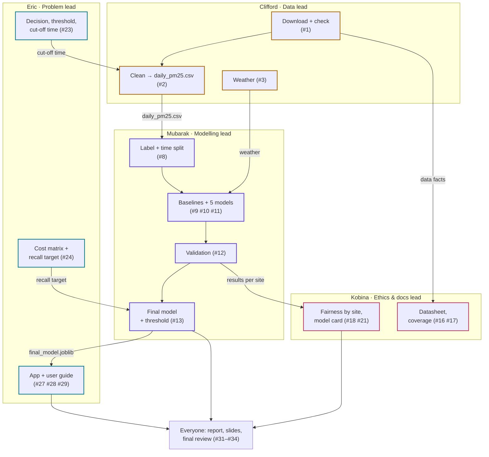

# AirWatch Accra

Next-day unhealthy-air warnings for Accra neighbourhoods, built with classical machine learning.

**Course:** ICS553 Machine Learning Essentials, Ashesi University, Fall 2026 (Final Capstone Project)
**Group 3:** Eric Elikplim Sunu (Problem lead) · Clifford Yeboah (Data lead) · Mubarak Tijani (Modelling lead) · Kobina (Ethics & documentation lead)
**Status:** see the [Roadmap issue](https://github.com/ASU-MICS-2028/mle-group-3-capstone/issues/35) for every task, owner and deadline.

## The problem in one sentence
Each evening, predict whether tomorrow's average PM2.5 at an Accra sensor site will go above
35 µg/m³ ("unhealthy for sensitive groups"), so a school head or district health officer can decide
whether to move outdoor activities indoors.

## How the pieces fit together

Who hands what to whom. Numbers are GitHub issues; the [Roadmap (#35)](https://github.com/ASU-MICS-2028/mle-group-3-capstone/issues/35) lists all 34, and the team board has an interactive map of every task.

**Critical path** (any delay here delays everything): #1 → #2 → #8 → #9 → #11 → #12 → #13 → #28.



## Layout
| Path | What goes in it |
|---|---|
| `src/` | Reusable Python modules, one job each (`config.py`, then data loading, features, models, validation). |
| `notebooks/` | Numbered notebooks (`01_…`, `02_…`) that import from `src/` and run top to bottom. |
| `tests/` | Automatic checks for `src/` (run with `python -m pytest -q`). |
| `app/` | The Streamlit app people actually use. |
| `docs/` | Problem framing, datasheet, model card, app explainer. |
| `reports/` | Report, result tables (CSV) and `figures/`. |
| `scripts/` | Command-line helpers (download data, run everything). |
| `data/` | Not committed. `data/README.md` says where each file comes from. |
| `models/` | Not committed. Saved trained models. |

## Setup
```bash
python -m venv .venv
source .venv/bin/activate      # Windows: .venv\Scripts\activate
pip install -r requirements.txt
python -m pytest -q            # check everything works
```

## How to reproduce (to be completed)
1. Download the data: *(script to come, `scripts/`)*
2. Build the dataset, train, evaluate: *(to come)*
3. Run the app: `streamlit run app/app.py`

## Conventions
- Constants (paths, seed, the 35 µg/m³ threshold) come from `src/config.py`, never hard-coded.
- Split by time, never at random. Preprocessing is fitted on training data only.
- Work on a branch (`problem/…`, `data/…`, `modelling/…`, `ethics/…`) and open a pull request;
  the reviewer in `TASKS.md` approves it.
- Keep personal notes in `personal/` (ignored by Git).

## Who does what
Roles and reviewers: `TASKS.md`. Every task is a GitHub issue, grouped by milestone in the
[Roadmap issue](https://github.com/ASU-MICS-2028/mle-group-3-capstone/issues/35).
